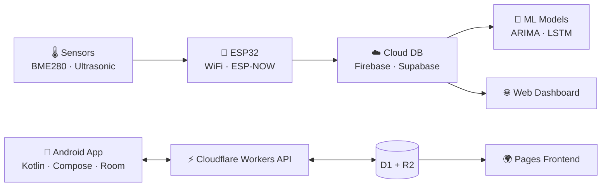

<div align="center">


<a href="https://git.io/typing-svg">
  
</a>

<br/>

[](https://firdous-rahaman.vercel.app)
[](https://linkedin.com/in/YOUR_LINKEDIN)
[](mailto:snxai.in@gmail.com)


</div>

---

## 👨‍💻 About Me

I'm an **Electronics & Communication Engineer** who likes owning the *whole* stack of a product, from the hardware to the app in someone's hand.

Lately I've been building **Android apps and web platforms on the Cloudflare edge** (Workers, D1, R2, Pages) alongside my **IoT and ML** work with ESP32 and sensor data.

> Most days: debugging sensors, fixing APIs, and making systems actually work in real life 😄

```text
🔭 Working on   →  AquaRoot, AirSense, sensor-data ML models
☁️ Focused on   →  Cloudflare Workers / D1 / R2 / Pages APIs
📱 Recently     →  Shipped DueBook and Study Notes (Android + web)
🤝 Open to      →  IoT / Android / full-stack collaborations
📫 Reach me     →  snxai.in@gmail.com
```

---

## 🚀 Featured Projects

| Project | What it is | Stack |
|---|---|---|
| 📒 [**DueBook**](https://duebook.tsrms.in/) | Offline-first digital khata for Indian shop owners: customer and supplier dues, payment reminders, cash calculator, PDF statements, encrypted backup. [On Google Play](https://play.google.com/store/apps/details?id=com.tsr.duebook) | Android · Next.js |
| 📚 [**Study Notes**](https://study-notes-user.pages.dev/) | Free study portal for West Bengal Board (Class 5–12) and job exams (RRB, WBPSC, SSC): dual-page book reader, KaTeX formulas, PYQs, timed quizzes, offline Android app | Cloudflare Workers · D1 · R2 · Pages · Jetpack Compose · Room |
| 💧 **AquaRoot** | Smart water tank automation: level monitoring and pump control | ESP32 · Ultrasonic · Relay |
| 🌍 **AirSense** | IoT air quality monitoring with live dashboard | ESP32 · BME280 · Realtime DB |
| 📊 **Sensor → ML** | Prediction models trained on collected sensor data | Python · TensorFlow · ARIMA · LSTM |

<!-- Tip: add repo links, e.g. [💧 AquaRoot](https://github.com/snx-ai/aquaroot) -->

---

## 🛠️ Tech Stack

**☁️ Cloudflare & Backend**


**📱 App & Web**


**⚡ Hardware & IoT**


**🤖 ML & Tools**


---

## 🏗️ How I Build Systems



---

## 📊 GitHub Stats

<div align="center">


</div>

---

## 🤝 Let's Connect

I'm always up for talking about Cloudflare, Android, IoT, or turning a messy idea into a working product.

<div align="center">

[](https://linkedin.com/in/YOUR_LINKEDIN)
[](mailto:snxai.in@gmail.com)
[](https://firdous-rahaman.vercel.app)

<br/>

<i>⚡ Building real-world systems, not just projects</i>


</div>
